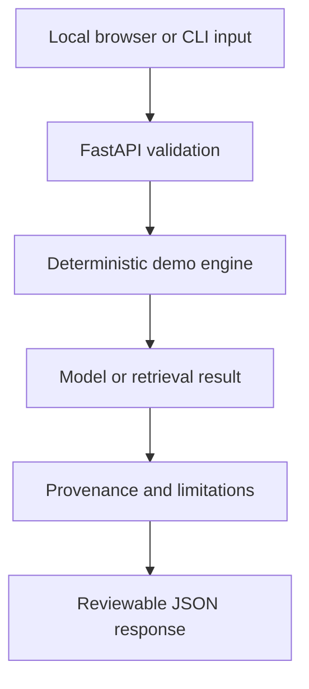

# Trusted Public Health Information Assistant — source tree and engineering map

> **Status:** offline synthetic-data portfolio demonstrator. No official live inputs, validated real-world benefit or production approval.

**Purpose:** Educational retrieval over fictional public-health reference notes; urgent questions require human/clinical escalation.

## Project file tree

```text
Trusted-Public-Health-Assistant/
├── .github/workflows/
│   ├── ci.yml                       # automated code, API, and artifact checks
│   └── import-standalone.yml        # verified one-time source-import process
├── app/
│   ├── main.py                      # project-specific FastAPI routes
│   ├── engine.py                    # deterministic analysis coordinator
│   ├── catalog.py                   # ten demo descriptors
│   ├── retrieval.py                 # evidence lookup / abstention
│   ├── classification.py            # small synthetic-text classifiers
│   ├── forecasting.py               # sample-only forecasting
│   ├── spatial.py                   # illustrative geospatial grouping
│   ├── records.py                   # review-oriented record matching
│   ├── sources.py                   # fictional references
│   ├── source_registry.py           # synthetic provenance metadata
│   └── storage.py                   # opt-in, minimal local run metrics
├── assets/
│   ├── cover.svg                    # original project illustration
│   ├── architecture.svg             # architecture graphic
│   └── synthetic-trend.svg          # fictional illustration, not measured results
├── docs/
│   ├── ARCHITECTURE.md
│   ├── MODEL_CARD.md
│   ├── THREAT_MODEL.md
│   ├── EVALUATION.md
│   ├── SECURITY.md
│   ├── DATA_STORAGE.md
│   ├── BASELINE_COMPARISON.md
│   ├── ACCEPTANCE.md
│   ├── workflow.mmd                 # Mermaid workflow source
│   └── PROJECT_STRUCTURE.md        # this guide
├── frontend/index.html             # one-project local browser interface
├── tests/test_demo.py              # health, source, sample, payload tests
├── cli.py                          # reproducible sample execution
├── sample_request.json             # fictional test input
├── Dockerfile
├── docker-compose.yml
├── pytest.ini
├── requirements.txt
└── README.md
```

## System workflow



**Run:** `python -m pip install -r requirements.txt`, `python -m pytest -q`, `python cli.py`, then `docker compose up --build` for the local web UI.

**Evidence:** [Architecture](../assets/architecture.svg) · [Graph illustration](../assets/synthetic-trend.svg) · [Model card](MODEL_CARD.md) · [Threat model](THREAT_MODEL.md) · [Mermaid diagram](workflow.mmd).

**Boundary:** labels, geographic locations, scheme details, risk signals, or medical wording from synthetic fixtures must not be represented as current verified public advice.
